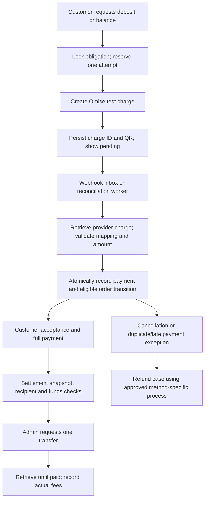

# Omise payment implementation plan

Research date: 18 October 2026. Status: proposed implementation; no real Omise integration or live activation has been performed.

## 1. Decision and scope

Use Omise as the first provider to investigate and integrate in **test mode**. Preserve the existing mock for isolated development. Start with asynchronous PromptPay collection, then build settlement and approved refund handling. Cards are a separate, optional delivery phase.

This is a Saan engineering decision, not confirmation that Omise has approved this merchant, marketplace structure, payout arrangement or payment schedule. Sandbox work can proceed while those live requirements are resolved. Do not describe Saan as a different business to obtain approval: disclose shrine sales, installation, relocation, maintenance, ceremonies and third-party providers accurately.

Do not introduce a customer wallet, withdrawable internal balance or an escrow claim. Saan records payment obligations and shop payables; Omise processes money under the eventual merchant agreement. Commission remains **unset**, rather than defaulting to 10% or zero for real orders.

## 2. Research findings and unresolved facts

Sources are official provider documents. Public documentation is evidence of a capability, not proof that a particular account has it enabled. Contract tests must record account mode, API version and observed responses without credentials or personal data.

| Topic | Evidence reviewed | Consequence for Saan |
|---|---|---|
| PromptPay | [PromptPay guide](https://docs.omise.co/promptpay): asynchronous QR flow; THB 20–150,000; configurable expiration up to 24 hours; live enablement required; void/refund through Omise is unsupported | A QR is a pending attempt. Revalidate each deposit/balance against provider limits. PromptPay refund support is a live blocker until an approved process exists. |
| Charge identity | [Charge API](https://docs.omise.co/charges-api) describes account-scoped `ref_id` preventing duplicate creation; [Thailand reference](https://docs.omise.co/charges-api/thailand) differs in detail | Verify support, duplicate response, payload mismatch, recovery lookup and scope in the actual account/version. Do not assume a Stripe-style idempotency header. |
| Webhooks | [Thailand webhook guide](https://docs.omise.co/api-webhooks/thailand) describes public HTTPS, signed requests and independent object retrieval; delivery retries are not guaranteed | Durable inbox plus scheduled reconciliation are required. The private Tailscale staging address cannot receive provider callbacks. |
| Transfers | [Transfer API](https://docs.omise.co/transfers-api/thailand): verified third-party recipients, separate sent/paid states, net amount and fees | Creating a transfer is not proof that a shop was paid. Verify gross-debit/net-credit semantics in sandbox before calculating payouts. |
| Recipients | [Recipients API](https://docs.omise.co/recipients-api/thailand) exposes verification/activation | Shop registration alone never permits a payout. Store provider recipient identity and verification state. |
| Refunds | [Refund API](https://docs.omise.co/refunds-api/thailand) is charge-specific | Select refund behavior by payment method and account capability. A generic refund endpoint does not imply PromptPay refunds are possible. |
| Marketplace option | [Omise PayFac](https://www.omise.co/th/payfac) offers platform-oriented merchant onboarding and payment management | Compare approved ordinary-account third-party transfers with PayFac. Do not infer PayFac pricing or access from standard gateway pricing. |
| Availability | [Balance explanation](https://docs.omise.co/what-are-the-total-on-hold-and-transferable-balance) describes a Thailand holding period of 7 days | Provider fund availability and customer acceptance are separate gates. This is not permission to hold funds indefinitely until a future appointment. Confirm account-specific terms. |
| Public prices | [Thailand pricing](https://www.omise.co/th/pricing/thailand): PromptPay 1.65%, cards 3.65%, transfer THB 20 up to THB 2 million, excluding 7% VAT; older help pages show different transfer fees | These are budgeting references, not Saan's agreed quote. Record actual provider fee fields and signed commercial terms. Recheck at implementation. |
| Merchant contract | [Thailand MSA, dated 2025-10-10](https://cdn.omise.co/assets/screenshots/Legal%20Documents/Omise-MSA-Thailand-Organic-ver-20251010.pdf), clauses 3.2, 3.5(c), 3.6 | Third-party services require express permission. The clause concerning divided payments means the deposit/balance milestone arrangement must be confirmed, rather than assuming a 30/70 split is acceptable. Do not add a customer gateway surcharge by default. |

The contract observations above identify questions to resolve; they are not a legal determination about Saan's eligibility.

### Required account/contract spike before real integration claims

1. Obtain test credentials through protected server configuration, never chat, Git, screenshots or `NEXT_PUBLIC_*`.
2. Pin and record the supported API version. Check the account capability response and actual PromptPay enablement.
3. Create a test QR using a server-side source/charge request. Verify field shapes, currency casing, QR URL, amount bounds and expiration behavior.
4. Verify the documented test-completion mechanism in the [testing guide](https://docs.omise.co/api-testing) or dashboard. Do not invent a publicly reachable “mark paid” route in Saan.
5. Probe duplicate `ref_id`, concurrent creates, changed amounts and a lost creation response. Establish a reliable same-operation recovery path. If recovery cannot prove whether a charge exists, stop at UNKNOWN and require reconciliation; do not issue another POST with a new key.
6. Verify webhook secret availability, signing behavior, rotation and event serialization for the chosen account version.
7. Probe transfer idempotency independently from charge idempotency, recipient checks, insufficient funds, fees, net amount and paid confirmation.
8. Record whether the ordinary account or PayFac is the approved production arrangement, its costs, holding limits, recipient requirements and who legally sells each service.
9. Obtain the permitted PromptPay cancellation/refund procedure, time limits and evidence requirements. Do not assume an unrelated bank transfer is an approved workaround.
10. Confirm genuine deposit and completion milestones with Omise, including appointments scheduled beyond normal settlement periods.

Items 8–10 block live operation; they do not block domain design or mock/test-mode development. Store findings in a dated contract-test report, with unresolved facts explicitly marked.

## 3. Current code and gaps

| Existing area | Useful foundation | Required change |
|---|---|---|
| `src/server/payment-gateway.ts` | Integer-satang boundary and explicit uncertain outcomes | Replace one generic execute shape with charge/refund/transfer capabilities and typed next actions |
| `src/server/payment-service.ts` | Reserve before provider call; atomic payment/order/event/notification finalization | Separate logical obligation from attempts; return QR/PENDING as a valid state; share authoritative finalization across workers/webhooks |
| `src/server/settlement-service.ts` | Refund/payout journal and duplicate protection | Remove universal refund assumption and gross-total payout assumption; add recipients, fee snapshots and pending transfer lifecycle |
| `src/server/integrations.ts`, `runtime-policy.ts` | Fail-closed production and allowlisted staging mock | Explicit mode selection and historical adapter resolution |
| Order payment UI | Existing deposit/balance actions and test notices | QR waiting/resume/check/expiry interface with truthful Thai status |
| Admin/provider finance | Operation history and manual reconciliation | Refund cases, recipient verification, fee breakdown, available-funds gate and exception queue |
| Prisma schemas/migrations | Durable journal, staging mock receipts and PostgreSQL deployment | Additive new records and constraints; preserve existing mock history |
| Home-server deployment | Portable image, PostgreSQL, nginx, backup/restore | Dedicated worker, public webhook ingress, outbound-mutation recovery switch and operational monitoring |

Today, successful mock refund/payout tests establish internal behavior only. They do not establish real provider support. The existing immutable stage key also cannot represent a safely expired QR followed by a fresh attempt.

## 4. Target flow and invariants



- Browser redirects, QR generation, screenshots and webhook payloads alone never mark a payment successful.
- Server derives order ownership, amount, payment stage and recipient. Ignore customer-submitted monetary values or destination references.
- A database uniqueness constraint and conditional claim protect each attempt across replicas. Provider requests occur outside database transactions.
- Persist `gateway`, provider-account namespace, test/live mode, currency, amount and reference immutably. Old operations resolve through their original adapter, not the currently selected default.
- `UNKNOWN` means uncertain, not failed. A timeout never authorizes a new charge, refund or transfer automatically.
- Success cannot be downgraded by stale events. Preserve conflicting provider evidence in an exception record.
- Finalization commits payment, journal, order event and notification together. Order completion and shrine creation occur once.
- Capture customer acceptance separately from the later system-originated payment confirmation, preserving who accepted and when.
- Every successful external charge is accounted for, including late, duplicate or canceled-order payments. Unexpected money creates an exception/refund case rather than disappearing.

### Suggested records and constraints

These are proposed responsibilities, not a requirement to use these exact model names.

| Record | Purpose / important constraints |
|---|---|
| `MoneyOperation` | Logical obligation; retain existing history and stable business keys |
| `PaymentAttempt` | Stage, sequence, immutable amount, provider account/mode, charge ID, request reference, QR expiry and state; unique stage/sequence and account/mode/provider charge ID; at most one unresolved active attempt per obligation |
| `ProviderEventInbox` | Unique account/mode/event ID, payload hash, received time, verification metadata, processing state and retry lease |
| `ProviderRecipient` | Shop-to-provider mapping, mode, verified/active flags, masked bank identity and change audit; never accept a client-selected arbitrary recipient |
| `RefundCase` | Original payment, entitlement, reason, supported procedure, requested/confirmed amount and evidence; request is distinct from completed refund |
| `SettlementSnapshot` | Immutable price basis, commission policy version, fee allocation, taxes, gross debit and expected shop net; actual fees reconciled separately |
| `PayoutReservation` | Prevent concurrent payouts from spending the same internally allocated provider funds; link one provider transfer |
| `ReconciliationJob` | Durable scheduling, cursor, lease, retries and last error; survives worker replacement |

All new amounts use integer satang with deterministic rounding. Retain legacy baht fields until an explicit audited conversion/backfill; never reinterpret existing integer values as satang. Use additive migrations in both the canonical schema and generated PostgreSQL workflow.

### States

Payment attempt: `CREATED -> DISPATCHING -> PENDING -> SUCCEEDED | FAILED | EXPIRED`; ambiguous dispatch or retrieval enters `UNKNOWN`. UI expiry is a countdown only. Confirm provider expiry/failure before allowing a replacement attempt, and keep detecting payments that arrive after cancellation.

Transfer: `RESERVED -> SUBMITTING -> PENDING -> SENT -> PAID`; uncertainty enters `UNKNOWN`, definitive rejection enters `FAILED`. Only confirmed payment closes the shop payable. A provider request may already exist after a local failure.

Refund case: `REQUESTED -> NEEDS_APPROVED_PROCESS | READY -> PROCESSING -> CONFIRMED`, with `UNKNOWN`/`FAILED` when appropriate. Unsupported PromptPay refunds must never set the original payment to REFUNDED merely because an admin pressed a button.

## 5. Collection and customer experience

- Start with PromptPay in test mode. Hide unimplemented card choices rather than letting users choose an unavailable method.
- Validate both deposit and balance independently against provider limits. If a stage is outside limits, explain in Thai; do not divide it further automatically to evade a limit.
- Store the provider charge identity before presenting its QR. Offer QR display, save instructions, amount, order reference, expiry and a “ตรวจสอบการชำระเงิน” action.
- Refreshing or reopening the order resumes the same pending attempt. Rate-limit manual checks server-side and use bounded backoff for background checks.
- Separate customer UI state “รอชำระเงิน”, “กำลังตรวจสอบ”, “ชำระแล้ว” and “ต้องตรวจสอบรายการ”; a pending result is not a generic form error.
- Reuse the design system, one order `StatusLine`, accessible `aria-live` updates and reduced-motion behavior. Keep test-mode notice beside the payment action.
- Do not promise universal banking-app deep links. Provide usable save-and-open instructions for the same-phone QR flow and test actual mobile behavior.
- Revisit cancellation: allow a cancellation intent without pretending an outstanding QR cannot still be paid. Stop replacement attempts and route late successful charges to a refund case.

## 6. Webhook, reconciliation and portable deployment

Recommended topology: retain the private staging application, add a narrowly exposed HTTPS receiver for the Omise webhook path, and run a separate worker from the same versioned application image. Use PostgreSQL for inbox/jobs; Redis or Kubernetes is unnecessary for this initial scale.

The exact domain/tunnel provider is still undecided. Do not expose the full admin application or alter webcam port 443 to make callbacks work. Private sandbox development can initially reconcile by authenticated provider GET; full callback acceptance requires a publicly reachable endpoint test.

Receiver design:

1. Read a size-limited raw body before JSON parsing. Verify HMAC-SHA256 using the Base64-decoded webhook secret and `timestamp.rawBody`; accept matching rotated signatures using constant-time comparison and an explicit five-minute replay window. Reject malformed signature lengths safely. These formats follow the [signature documentation](https://docs.omise.co/api-webhooks/thailand).
2. Reject wrong environment/account mappings. Deduplicate events durably; return 2xx only after storage succeeds. Failed persistence returns a retryable error, with reconciliation covering missing deliveries.
3. A worker retrieves the referenced object with server credentials and checks charge identity, amount, currency, mode and Saan attempt mapping before finalizing. Do not trust metadata alone as ownership proof.
4. Process out-of-order events idempotently. Subscribe only to needed charge, refund, recipient and transfer events; do not depend on every method emitting identical event names.

Worker design:

- PostgreSQL leases/conditional claims, bounded batches, exponential backoff with jitter, capped retry pressure and explicit handling of rate limits.
- Reconcile pending/unknown charges, outstanding refunds/transfers, recipient state and provider balance/fee evidence. A browser tab is never the scheduler.
- Fetch/list with stored cursors and overlap where required; deduplicate by provider identity. Define reconciliation frequency after observing API limits, rather than hardcoding undocumented quotas.
- Report stale unknown operations, failed jobs and mismatched totals in the admin queue. External notification channels require separate configuration; this plan sends no messages.
- Keep secrets out of logs, redact payloads and define limited access/retention for provider event data. Store bank data minimally, preferably provider references plus masked identity.
- Docker image, environment configuration, database and upload volumes remain separable so the stack can move to another home server or VDS without changing payment identities.

## 7. Fees, commission and payout policy

Commission and fee allocation are product decisions still required before live settlements. Recommended initial proposal for discussion: one clearly disclosed shop commission, no automatic customer gateway surcharge, and an explicit agreement about who bears collection/transfer fees. Do not activate this proposal as a rate.

Snapshot these values per order: gross sale, refunds, commission basis/rate/amount, processing fee, provider fee VAT, transfer fee/VAT, shop net and platform net. Estimates shown before payment must be labeled; actual provider amounts determine reconciliation.

Calculation contract:

```text
shop entitlement = sale - confirmed refunds - agreed commission - shop-allocated fees/taxes
platform net      = agreed commission - platform-allocated fees/taxes
provider debit    = shop bank net + transfer costs, subject to verified provider semantics
```

Do not subtract a fee twice. The exact Omise transfer amount/net behavior must be demonstrated before enabling payout. VAT on the provider's fee is separate from Saan's own tax obligations; accounting treatment and withholding remain to be confirmed for the business arrangement.

Payout eligibility requires all of:

- Job accepted and order complete; exact required payment received.
- No open cancellation, refund, dispute, overpayment or reconciliation exception.
- Recipient verified, active and still matching the locked settlement destination.
- Agreed settlement policy and immutable fee snapshot; enough provider available balance and internal unreserved allocation.
- Provider holding/availability conditions satisfied for every collected installment.

Earliest payout is after both acceptance and actual provider availability, not immediately after the customer taps acceptance. Bank-account changes suspend unpaid payouts until re-verification. Initially retain an authenticated admin initiation step; workers monitor the same transfer rather than launching new ones.

## 8. Delivery sequence and exit criteria

| Phase | Work and likely files | Exit criterion |
|---|---|---|
| 0 — Contract spike | Protected test configuration, API probes and dated evidence report | Actual account behavior documented; uncertainty/retry policy explicit; no fabricated sandbox success |
| 1 — Domain foundation | Gateway boundary, runtime policy, payment/settlement services, additive Prisma migration, attempt records | Existing mock workflows still pass; mode isolation and repeated-attempt constraints pass on PostgreSQL |
| 2 — QR collection | Omise test adapter, order action response, QR waiting/resume UI | Deposit and balance paid through actual test-provider confirmation; restart resumes pending charge |
| 3 — Delivery and recovery | Webhook route, durable inbox, worker, Compose service, reconciliation/admin exceptions | Valid public callback works; lost/duplicate/out-of-order callbacks and worker restart recover once |
| 4 — Cancellation/refunds | Refund cases, entitlement policy, late-payment handling, admin UI | Unsupported method cannot be falsely refunded; late payment recorded; supported process verified separately |
| 5 — Shop settlement | Recipient onboarding, policy snapshots, fee calculations, fund reservations and transfer adapter | Test shop receives the expected net; sent is distinct from paid; no duplicate transfer under failure |
| 6 — Cards, optional | Hosted/tokenized entry, redirect/3DS handling, method-specific refunds/disputes | No PAN/CVC reaches Saan; cancellation, authentication and dispute holds have acceptance tests |
| 7 — Release rehearsal | Full test-mode journey, restore/reconcile drill, operational runbook and readiness report | Evidence complete; unresolved live blockers listed; explicit live activation decision remains separate |

Phases 0–3 are the first development milestone. Run phases 4–5 before claiming an end-to-end marketplace payment system. Cards can move ahead of live PromptPay if they provide an approved, tested refund path and the business flow is accepted.

Planning estimate: approximately 15–25 focused engineering days for phases 0–5 and 7, excluding account approval, external access, policy decisions and significant discoveries; optional cards add approximately 3–6 days. These are estimates to revise after phase 0, not a delivery commitment.

## 9. Required acceptance tests

Use isolated databases and real provider test credentials for contract tests. SQLite-only tests are insufficient for financial concurrency; run all applicable payment/settlement integration scenarios on PostgreSQL, including equivalent fault injection where current SQLite-specific tests use triggers.

| Group | Cases that must pass |
|---|---|
| Idempotency | Double click, concurrent replicas, same key/different amount, lost POST response, retry after restart, missing provider reference |
| Authorization | Another customer's status/QR access, tampered amount, arbitrary recipient, non-admin settlement action, wrong provider account or mode |
| Confirmation | Wrong amount/currency, metadata collision, forged/unsigned/expired/malformed signatures, duplicate events, out-of-order events, missing callbacks |
| Transaction recovery | Provider success followed by database rollback; finalization retried; order completion/shrine/notification occurs once |
| QR lifecycle | Expiry boundary race, payment while cancellation happens, late successful payment, reopened browser, verified replacement attempt, overpayment exception |
| Refund | Unsupported PromptPay path, full refund entitlement, failed/unknown refund, duplicate request, actual completion evidence, fee not automatically returned |
| Settlement | Unverified/inactive/changed recipient, insufficient or reserved balance, fee rounding, gross/net mismatch, pending/sent versus paid, duplicate payout, refund/dispute after payout exception |
| Operations | Worker crash/lease reclaim, provider 429/timeout, deployment restart, secret rotation, stale unknown alert, provider unavailable UI |
| Restore | Restore pending attempts/inbox/settlements without executing a second external operation; reconcile external truth before outbound mutations resume |

Keep sanitized provider fixtures plus observed contract-test results. A mock assertion and an actual Omise sandbox result are different evidence and must be reported separately.

## 10. Migration, rollback and operational safety

- Back up before schema changes using the existing home-server process. Preserve current mock receipts and payment history. No reset/seed on persistent data.
- Deploy schema additions first, then compatible app/worker. Gate Omise test traffic separately from mocks. Existing historical operations remain resolvable.
- Rollback means stop new provider mutations and retain reconciliation access; do not delete paid rows or switch old operations to the mock.
- Restoring a database rewinds local knowledge but not external money. Start restored stacks with outbound financial mutations disabled, retrieve/reconcile provider objects and audit missing operations before resuming. Never blindly replay restored CREATED jobs.
- Keep current backups on the home server as instructed by the owner; off-machine copies are not authorized. Record the single-machine disaster-recovery limitation in readiness review.
- Review existing dependency audit findings and production authentication/SMS readiness before public release. Private staging's synthetic-phone authentication is not a production customer login system.

## 11. Live readiness gates and remaining owner decisions

Before enabling real collection or payouts:

1. Omise has accepted the actual business and marketplace structure, milestones, recipient arrangement and holding period.
2. An approved, operational refund path exists for every enabled method, especially PromptPay, with customer-facing timing and support ownership.
3. Commission, fee allocation, cancellation entitlements, payout timing and accounting treatment are decided and versioned.
4. Real authentication/admin controls, separate live secrets, signed public webhooks, worker/reconciliation and monitoring are verified.
5. Contract, PostgreSQL concurrency, full journey and restore tests have evidence; live mode cannot be selected accidentally with test keys or staging mock flags.
6. A deliberate live activation and limited initial rollout are authorized after the readiness report. Sandbox approval does not authorize charging real money.

Next concrete action: phase 0 account contract spike, followed by phase 1 domain refactor. No need to buy PayFac or expose the full staging site merely to begin the engineering work.
